# Chapter 1 — The Data Analyst Interview, End to End

Most people prepare for a data analyst interview by collecting questions. They bookmark a SQL practice site, download a statistics cheat sheet, and skim a list of "top 50 behavioral questions." Then they walk into the process and discover that the interview is not a pile of questions — it is a **sequence of distinct stages, and each stage is testing something different.** The recruiter screen is not a smaller version of the technical round. The case round is not graded like the SQL round. Candidates who don't know this ace the SQL screen, then freeze when the case interviewer asks what metric they'd even look at.

This chapter gives you the map. By the end of it you'll be able to name every stage of a real data analyst interview and say what each one is actually evaluating. You'll also build a prep plan that spends your time where your gaps are — not where the internet's questions happen to pile up.

## The process, start to finish

A typical entry-level data analyst interview runs as roughly five blocks, in this order:

1. **Recruiter screen** — a 15-to-30-minute call covering your résumé, your motivation, salary expectations, and logistics. No coding.
2. **Hiring-manager chat** — a conversation about your direct experience and why you want this role and team.
3. **Technical screen** — SQL and often Python, delivered as a live shared editor or a take-home with a messy dataset.
4. **Statistics / experimentation round** — reasoning about distributions, hypothesis tests, and A/B tests.
5. **Case / business round** — an open business or metrics problem, increasingly a take-home you then present.
6. **Behavioral round** — how you collaborate, handle ambiguity, and recover from setbacks.

(That's "roughly five blocks" because the hiring-manager chat and the statistics round are sometimes folded into neighbors.) Most processes run **three to five rounds over two to six weeks**; startups compress to two or three, while larger and FAANG-adjacent companies can run longer.[^trends1]

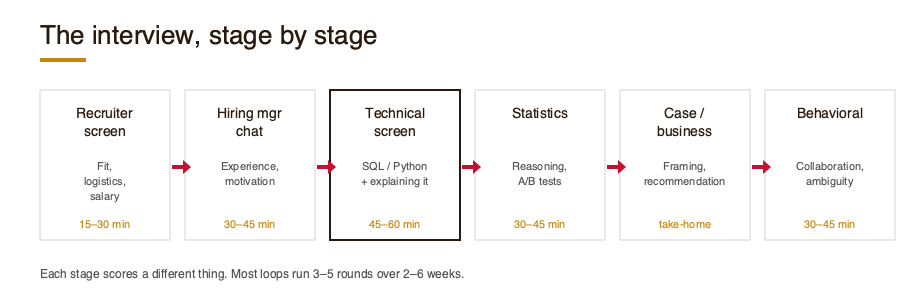

## What's tested where

One thing separates candidates who prep well from candidates who just prep hard: **each stage scores a different thing.** Learn this matrix before anything else.

| Stage | What the interviewer is really scoring |
|---|---|
| Recruiter screen | Basic fit, communication, do the logistics/salary line up |
| Hiring-manager chat | Relevant experience, genuine motivation, team fit |
| Technical screen | Correct SQL/Python **and** how clearly you explain your logic |
| Statistics round | Sound reasoning under uncertainty; stating assumptions |
| Case / business round | Framing, assumptions, insight, and a defensible recommendation — over raw correctness |
| Behavioral round | Collaboration, ownership, handling ambiguity, influence |

In the technical screen, a query that runs but that you can't explain is a weak answer: interviewers grade logic and communication, not just whether the code executes.[^trends1] In the case round, the "right number" matters less than whether you framed the problem well. Preparing without this matrix is how strong candidates give technically-correct answers that still don't land.

## What changed by 2026

Three things changed how these interviews run, and scattered older resources haven't caught up:[^trends1]

- **AI-tool fluency is now assessed.** You may be asked how you use tools like ChatGPT or Cursor responsibly. They want to see *judgment*: when to lean on the tool, and when to read the generated query line by line — because AI output can pass a surface smell test and still be subtly wrong. (Chapter 7 has a full section on this.)
- **Take-home case studies are common.** Mid-to-large companies increasingly send a real-feeling business question built on intentionally messy data, with a time cap and a presentation. (Chapter 8 rehearses the format.)
- **Communication and business framing are weighted heavily.** The later rounds reward stakeholder translation and judgment about *which question is worth answering* — not just the ability to compute.

## How to use this book

The chapters follow the order you'll actually experience the interview: orientation (this chapter), the recruiter screen, the technical rounds (SQL, statistics, spreadsheets, Python), the case round, the behavioral round, and finally a full mock loop. Each stage chapter opens with a **"What's tested here"** box — the same idea as the matrix above, zoomed in — and then drills that skill with practice questions.

Two things about those practice questions. First, they are **leveled**: warm-up, then representative, then stretch, so you always know how hard the rep is. Second, **every question in this book is original** — invented companies, invented datasets, invented metrics — written to exercise the same skills real interviews test. Nothing here is copied from a question bank. That means you can trust the practice to build skill rather than memorized answers.

## Worked example: a three-week prep plan

Meet Maya. She graduated eight months ago with an economics degree (two statistics courses, one intro-to-databases course), finished a three-month analytics bootcamp, and has interviews starting in three weeks. She can write a `SELECT ... JOIN` and build a pivot table. She has never done a take-home case or told a behavioral story that landed.

A plan that spends time by *stage weight and personal gap* — rather than evenly — might look like this:

- **Week 1 — shore up the technical floor.** SQL is the most-tested skill and Maya is slow, so: SQL I and II (Chapters 3–4), 90 minutes a day, plus the statistics round (Chapter 5) she half-remembers.
- **Week 2 — the parts she's never done.** Spreadsheets and pandas (Chapters 6–7) for maintenance, but the real investment goes to the case round (Chapter 8) — the format she's never seen — including one full take-home.
- **Week 3 — integrate and rehearse.** Behavioral stories (Chapter 9), then the full mock loop (Chapter 10) twice, self-scoring each stage and re-drilling her two weakest.

Notice the plan is *lopsided on purpose.* Maya isn't spending equal time on each stage; she's spending most on the stages she's weakest at and that count most.

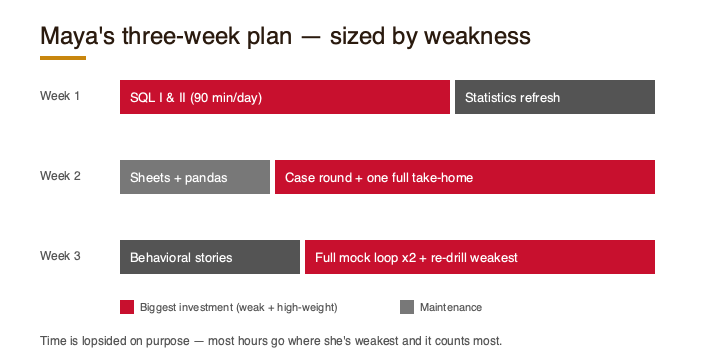

## Exercises

**1. (Warm-up.)** Match each prompt to the stage it belongs to:
(a) "Walk me through your résumé and what you're looking for." (b) "Write a query to find the top 3 products by revenue." (c) "How would you measure whether a new feature succeeded?" (d) "Tell me about a time you disagreed with a teammate." (e) "Is this A/B test result trustworthy?" (f) "Why do you want to work here specifically?"

**2. (Representative.)** Read this short profile: *"Confident on SQL and Excel from a data internship; has never done a case study or a structured behavioral round; interviews in four weeks."* Name the **two stages** this person should invest the most in, and explain why in one sentence each.

**3. (Stretch.)** Using the three-week template above, write your **own** prep plan: self-assess each stage as strong / okay / weak, then allocate your available hours so the most time goes to high-weight, low-confidence stages.

---

*Next:* before any code, the interview starts with a human on the phone. Chapter 2 takes apart the recruiter and hiring-manager screen — what those early calls are really checking, and how to pass them without over-sharing or freezing on the salary question.

[^trends1]: Interview-structure and 2026-trend claims in this chapter are drawn from current data-analyst interview guides (DataCamp, Exponent, BrainStation, KORE1, Interview Query), recorded in `blueprint-trends-notes.md`. These describe the hiring *process*; they are not used as authorities for technical facts.
# Chapter 2 — The Recruiter & Hiring-Manager Screen

The interview starts with a human on the phone, not a query editor. Two early calls gate everything after them — and each is checking something different.

> **What's tested here**
> - **Recruiter screen:** basic fit, communication, and whether the logistics (salary, timeline, location) line up. *No coding.*
> - **Hiring-manager chat:** relevant experience and genuine motivation — *why this role, why this team.*[^trends2]

## The two calls, side by side

| | Recruiter screen | Hiring-manager chat |
|---|---|---|
| Length | ~15–30 min | ~30–45 min |
| Really checking | Fit, communication, logistics | Direct experience, motivation, team fit |
| Coding? | No | Rarely |
| Kills you | Rambling, badmouthing, no questions | Vague experience, no reason for *this* job |

## "Tell me about yourself" — a structure

Don't narrate your life. Use **present → past → why**:

- **Present:** what you do / just finished (one line).
- **Past:** the one or two experiences most relevant to *this* role.
- **Why:** why this role and company, now.

Sixty seconds, not five minutes.

## Motivation without flattery

"Why this company?" is answered with **specifics**, not praise. Name the product, the team's problem, or the kind of data work — something that shows you looked.

## Logistics and salary

- Give a **range** you've researched, not a single number.
- State your **timeline** and any competing processes honestly.
- Don't anchor low out of nervousness — this is a screen, not a negotiation.

## Worked example (annotated)

**Q: "So, tell me about yourself."**

*Weak:* "I was born in… I studied economics… I like data… I did a bootcamp…" (chronological, no focus).

*Rewrite:* "I just finished an analytics bootcamp after an economics degree — **present**. Before that I spent a summer pulling sales data in SQL for a retail internship, which is where I got hooked on turning messy data into a clear answer — **past**. I'm looking for an entry-level analyst role on a team where I'll write real queries against real business questions, which is exactly what this role looks like — **why**."

*Margin note:* the rewrite is scored well because it's concise, relevant, and ends pointed at *this* job.

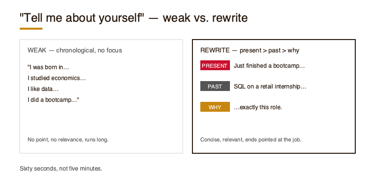

## Exercises

1. **(Warm-up.)** For each question, name what the caller is *really* checking: (a) "What are your salary expectations?" (b) "Why are you leaving your current situation?" (c) "What questions do you have for me?"
2. **(Representative.)** Draft your own 60-second "tell me about yourself" using present → past → why.
3. **(Stretch.)** Here's a salary exchange: *"What are you looking for?" — "Um, whatever's fair, I'm flexible, whatever the range is."* Diagnose two mistakes and rewrite the candidate's line.

---

*Next:* you've cleared the humans. Now the query editor. Chapter 3 starts SQL — the most-tested technical skill in the loop.

[^trends2]: Stage descriptions from current data-analyst interview guides recorded in `blueprint-trends-notes.md`; coaching content is editorial.
# Chapter 3 — SQL I: Querying, Filtering, and Joins

SQL is the skill nearly every technical screen assumes. This chapter builds the core: a correct query, the right join, and the ability to *explain what you wrote.* All examples use **MySQL**.

> **What's tested here**
> Correct SQL **and** clear reasoning. A query that runs but that you can't explain is a weak answer — screens grade logic and communication, not just execution.[^trends3]

## What SQL is

SQL is a domain-specific language for managing data in a relational database.[^sql] Its statements group into families — querying (`SELECT`), definition (`CREATE`), manipulation (`INSERT`/`UPDATE`/`DELETE`), and control. Interviews live almost entirely in `SELECT`.

**Dialects differ.** Date syntax, string handling, `NULL` behavior, and identifier casing vary by vendor, so SQL rarely ports unchanged between engines.[^sql] This book standardizes on MySQL.

## The query skeleton

```sql
SELECT   column(s)
FROM     table
WHERE    row filter
GROUP BY grouping column(s)
HAVING   group filter
ORDER BY column(s)
LIMIT    n;
```

Two traps interviewers watch for:
- **`WHERE` filters rows; `HAVING` filters groups.** You can't filter an aggregate in `WHERE`.
- Logical evaluation runs roughly `FROM → WHERE → GROUP BY → HAVING → SELECT → ORDER BY → LIMIT`, which is why a column alias from `SELECT` isn't always usable in `WHERE`.

## Joins — pick by the relationship

| Join | Returns |
|---|---|
| `INNER JOIN` | Only rows with a match in **both** tables.[^join] |
| `LEFT JOIN` | **All** left rows + matches; unmatched right columns are `NULL`.[^join] |
| `RIGHT JOIN` | All right rows + matches; unmatched left columns are `NULL`.[^join] |
| Self-join | A table joined to itself, using aliases.[^join] |

**Rule of thumb:** "everyone, plus their data if any" → `LEFT JOIN`. "Only matched pairs" → `INNER JOIN`.

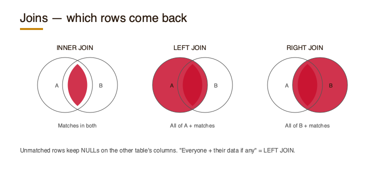

## Worked example — FreshCrate

Schema for an invented meal-kit company:
`customers(id, name, city)` · `orders(id, customer_id, ordered_at)` · `order_items(order_id, product, price)`

**Q: For each city, how many customers placed at least one order in 2025?**

```sql
SELECT   c.city,
         COUNT(DISTINCT c.id) AS active_customers
FROM     customers c
JOIN     orders o ON o.customer_id = c.id
WHERE    o.ordered_at >= '2025-01-01'
     AND o.ordered_at <  '2026-01-01'
GROUP BY c.city;
```

*Say it aloud:* "Inner-join customers to orders so I only keep customers who ordered, restrict to 2025 dates, group by city, and count distinct customers so multiple orders don't double-count." The query is half the answer; saying it out loud like that is the other half.

## Exercises (FreshCrate schema)

1. **(Warm-up.)** List all customers who have **never** placed an order. *(Hint: `LEFT JOIN` + `WHERE ... IS NULL`.)*
2. **(Representative.)** Given a one-to-many relationship (one customer, many orders), if you `JOIN` customers to orders, do the customer rows inflate? Explain what happens and why `COUNT(DISTINCT ...)` fixes it.
3. **(Stretch.)** Return the **top 3 cities by total 2025 revenue**, where revenue is the sum of `order_items.price`.

---

*Next:* the SQL that separates candidates — window functions and the recurring problem patterns.

[^trends3]: `blueprint-trends-notes.md`.
[^sql]: Wikipedia, "SQL," https://en.wikipedia.org/wiki/SQL (accessed 2026-07-15).
[^join]: Wikipedia, "Join (SQL)," https://en.wikipedia.org/wiki/Join_(SQL) (accessed 2026-07-15).
# Chapter 4 — SQL II: Aggregation, Window Functions, and Problem Patterns

Basic joins get you into the room; **window functions and pattern recognition** get you the offer. This chapter covers the harder SQL and the handful of problem shapes that recur. MySQL 8.0+ assumed — CTEs arrived in 8.0.1 and window functions in 8.0.2.[^mysqlver]

> **What's tested here**
> Can you reach past `GROUP BY` when the question needs per-row context — and can you *name the pattern* fast, then write it correctly and efficiently.

## CTEs: readable multi-step logic

A common table expression (`WITH`) names an intermediate result so a query reads top-to-bottom instead of nesting inside-out. Prefer them for anything with two or more steps.

## Window functions vs. GROUP BY

A **window function computes a value for each row using a set of rows, without collapsing them** — unlike aggregation with `GROUP BY`, which collapses each group to one row.[^win] They use an `OVER` clause with optional `PARTITION BY` (the groups) and `ORDER BY` (the order within each). Omit `PARTITION BY` and the whole result is one partition.[^win]

The ones to know:[^win]

| Function | Does |
|---|---|
| `ROW_NUMBER()` | Sequential number per partition |
| `RANK()` | Position with **gaps** for ties |
| `DENSE_RANK()` | Position with **no gaps** for ties |
| `LAG()` / `LEAD()` | Previous / next row's value |
| `SUM() OVER (...)` | Running / windowed total |

## The recurring patterns

Most SQL questions are one of a few shapes. Learn to name them on sight:

- **Top-N per group** → `ROW_NUMBER()` partitioned by the group, filtered to `rn <= N`.
- **Running total** → `SUM() OVER (ORDER BY ...)`.
- **Month-over-month / change** → `LAG()`.
- **Gaps & islands** → row-number differencing.
- **Deduplication** → `ROW_NUMBER()` keep `= 1`.

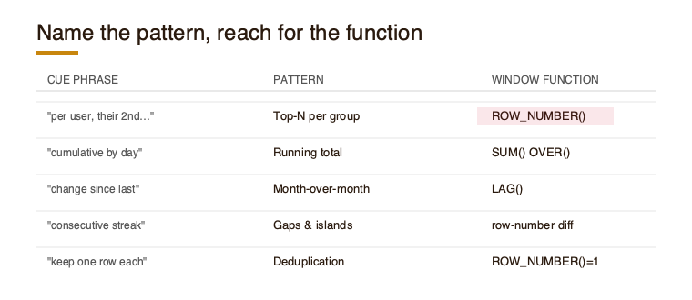

## Worked example — Loopr

Invented streaming service. `plays(user_id, track_id, played_at)`.

**Q: For each user, find their 2nd-most-played track.**

```sql
WITH counts AS (
  SELECT user_id, track_id, COUNT(*) AS plays
  FROM   plays
  GROUP  BY user_id, track_id
),
ranked AS (
  SELECT user_id, track_id, plays,
         ROW_NUMBER() OVER (PARTITION BY user_id ORDER BY plays DESC) AS rn
  FROM   counts
)
SELECT user_id, track_id, plays
FROM   ranked
WHERE  rn = 2;
```

**Why a naive `GROUP BY` fails:** grouping collapses each user to one row, so there's no way to point at "the 2nd" — you need per-row ranking *within* the user, which is exactly what the window function preserves.[^win]

## Exercises (Loopr schema)

1. **(Warm-up.)** Compute a **7-day running total** of plays per day using `SUM() OVER`.
2. **(Representative.)** Given the prompt *"the play with the largest gap since a user's previous play,"* name the pattern and the window function you'd use.
3. **(Stretch.)** A candidate's "top track per user" query uses `RANK()` and returns two rows for users with a tie. Find the bug and fix it so exactly one row returns per user.

---

*Next:* numbers without code — statistics, probability, and experimentation.

[^win]: Wikipedia, "Window function (SQL)," https://en.wikipedia.org/wiki/Window_function_(SQL) (accessed 2026-07-15).
[^mysqlver]: MySQL 8.0 Reference Manual, "What Is New in MySQL 8.0" (https://dev.mysql.com/doc/refman/8.0/en/mysql-nutshell.html); CTEs introduced in 8.0.1, window functions in 8.0.2. Accessed 2026-07-15.
# Chapter 5 — Statistics, Probability & Experimentation

This round rarely wants a proof. It wants to see you **reason under uncertainty and state your assumptions** — and not fall for the classic traps.

> **What's tested here**
> Sound reasoning out loud, correct use of core concepts, and spotting a flawed experiment. Confidently *wrong* (especially about p-values) is worse than "let me state my assumptions."

## Hypothesis testing, in interview language

- **Null hypothesis (H₀):** the default — "no effect," or the parameter takes an obvious value. **Alternative (H₁):** its negation.[^hyp]
- **p-value:** the probability of a test statistic **at least as extreme** as observed, *assuming H₀ is true.*[^hyp]
- **Significance level (α):** the largest false-positive rate you'll accept; commonly 5% or 1%. If p < α, you reject H₀ at that level.[^hyp]

> ⚠️ **The trap.** A p-value is **not** the probability that the null (or your hypothesis) is true — a well-known source of confusion.[^hyp] Say "under the null, a result this extreme has a 3% chance," never "there's a 97% chance my hypothesis is right."

## A/B testing

An **A/B test is a randomized experiment comparing two or more variants** to see which performs better, applying hypothesis testing to the difference.[^ab]

Watch for these pitfalls:[^ab]
- **Too-small samples** — tests are sensitive to variance and need enough data to detect a real difference.
- **Biased splits** — unequal distribution across user segments skews results.
- **Vague outcomes** — the metric must be defined and measurable up front.
- **Peeking / early stopping** — checking daily and stopping when it looks significant inflates false positives.

## Probability questions

Common shapes: conditional probability, expected value, simple combinatorics. Method matters more than speed — define the sample space, state assumptions, then compute.

## Worked example

An invented food-delivery app tests a new checkout button. Conversion moves **4.0% → 4.3%** over a week.

Reason it through aloud:
1. **H₀:** the button doesn't change conversion. **H₁:** it does.
2. **Test:** compare conversion rates between groups (a proportions test).
3. **Trust check:** Was the sample big enough for a 0.3-point move? Were users split randomly? Did we fix the metric and duration *before* peeking?
4. **Before shipping:** confirm significance at a pre-set α, check for novelty effects, and look at guardrail metrics (e.g., did average order value drop?).

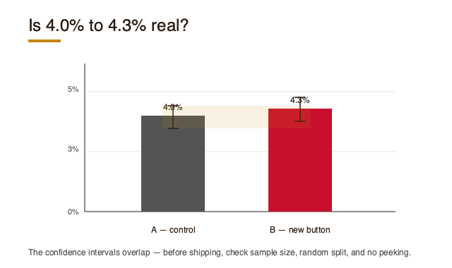

## Exercises

1. **(Warm-up.)** In plain language, what does a p-value of **0.03** mean — and what does it *not* mean?
2. **(Representative.)** A team ran an A/B test, checked results every day, and stopped the moment it hit significance. Name the flaw and its effect on the false-positive rate.
3. **(Stretch.)** A game pays \$10 on heads, costs \$4 to play, fair coin. Compute the expected value and say whether you'd play — narrating your reasoning.

---

*Next:* the tool interviewers still reach for — spreadsheets under time pressure.

[^hyp]: Wikipedia, "Statistical hypothesis test," https://en.wikipedia.org/wiki/Statistical_hypothesis_test (accessed 2026-07-15).
[^ab]: Wikipedia, "A/B testing," https://en.wikipedia.org/wiki/A/B_testing (accessed 2026-07-15).
# Chapter 6 — Spreadsheets for Analysts

Spreadsheets are still where many analyst interviews test whether you can **clean and summarize messy data quickly** — often live, often on a deadline.

> **What's tested here**
> Speed and correctness on real data: the right lookup, a fast aggregation, and the judgment to clean before you analyze.

## Formulas that earn their keep

- **Conditional aggregation:** `SUMIFS`, `COUNTIFS`, `AVERAGEIFS` — totals and counts by criteria.
- **Logic:** `IF`, nested sparingly.
- **Text/date cleanup:** `TRIM`, `LOWER`/`UPPER`, `LEFT`/`RIGHT`, date parsing.

> **Argument order (verified against Microsoft docs):** `COUNTIFS(criteria_range1, criteria1, …)` — but `SUMIFS(sum_range, criteria_range1, criteria1, …)` puts the **sum range first.** Mixing these up is a classic slip.[^xlfns]

## Lookups — and how they fail

| Function | Note | Classic failure |
|---|---|---|
| `VLOOKUP` | Lookup value must be in the **leftmost** column; **defaults to approximate match** | Silent wrong values when columns shift or the table isn't sorted |
| `INDEX`/`MATCH` | More flexible; look up in any column | More typing, easy to mismatch ranges |
| `XLOOKUP` | Modern replacement; **defaults to exact match** | Not in older Excel versions |

**Interview tip:** the most common lookup bug is `VLOOKUP`'s **approximate-match default returning the wrong row.** Prefer exact match (`FALSE` in `VLOOKUP`, the default in `XLOOKUP`) unless you mean otherwise.[^xllookup]

## Pivot tables

A **pivot table aggregates groups of values from a larger table** — sums, averages, counts by category — organized into filters, rows, columns, and values.[^pivot] It's the fastest way to answer "X by Y" without writing formulas.

## Cleaning messy data

Before any analysis, scan for: **duplicates, inconsistent categories** (`Boston` vs `boston`), **bad/mixed date formats**, and **trailing spaces**. Name what you find — interviewers want to hear you *notice* the mess.

## Choosing the tool

Spreadsheet for quick, visual, one-off summaries; SQL when the data lives in a database or is large; Python when the transform repeats or gets complex.

## Worked example

An invented **conference-signups** sheet has duplicate emails, mixed-case cities, and two date formats. Steps:
1. `TRIM`/`LOWER` the city column; standardize dates.
2. Remove duplicate emails (keep first).
3. Pivot: signups by city.

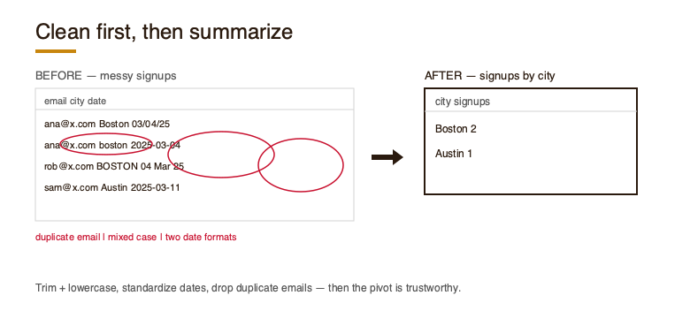

## Exercises

1. **(Warm-up.)** Write a `COUNTIFS` for "signups from 'Boston' in March."
2. **(Representative.)** A `VLOOKUP` returns wrong values after a colleague inserted a column. Diagnose which failure mode caused it.
3. **(Stretch.)** For a described task, decide whether it belongs in a spreadsheet, SQL, or Python — and justify in two sentences.

---

*Next:* when the interview wants code, it usually means Python and pandas — plus a new 2026 question about how you use AI tools.

[^pivot]: Wikipedia, "Pivot table," https://en.wikipedia.org/wiki/Pivot_table (accessed 2026-07-15).
[^xlfns]: Microsoft Support, "COUNTIFS function" (https://support.microsoft.com/en-us/excel/functions/countifs-function) and "SUMIFS function" (https://support.microsoft.com/en-us/office/sumifs-function-c9e748f5-7ea7-455d-9406-611cebce642b), accessed 2026-07-15.
[^xllookup]: Microsoft Support, "VLOOKUP function" (https://support.microsoft.com/en-us/office/vlookup-function-0bbc8083-26fe-4963-8ab8-93a18ad188a1) and "XLOOKUP function" (https://support.microsoft.com/en-us/excel/functions/xlookup-function), accessed 2026-07-15.
# Chapter 7 — Python & pandas for Analysts (+ AI Tools)

When the coding round wants Python, it usually wants **pandas**: load, clean, group, summarize, answer. This chapter also covers a question that's new to 2026 loops — *how do you use AI tools responsibly?*

> **What's tested here**
> A small data problem solved end-to-end in pandas, narrated clearly — plus judgment about when to trust AI-generated code.

## pandas in one screen

**pandas is a Python library for data manipulation and analysis.**[^pd] Two structures do the work:[^pd]
- **`Series`** — a 1-D labeled array.
- **`DataFrame`** — a 2-D labeled table; each column is a `Series` and can hold a different type. Built from dicts, arrays, or files (CSV, Excel, JSON, SQL).

Core operations you'll use constantly:[^pd]
- **Filter:** `df[df['col'] > 5]`
- **Group:** `df.groupby('key').agg(...)` (split-apply-combine)
- **Join:** `df.merge(other, on='key', how='left')`
- **Sort:** `df.sort_values('col', ascending=False)`

> **Limitation to mention:** pandas holds data in RAM and doesn't parallelize across cores or optimize query plans — fine for interview-sized data, not for billions of rows.[^pd]

## SQL ↔ pandas

Same question, two tools. "Revenue by city" is `GROUP BY city` in SQL and `df.groupby('city')['revenue'].sum()` in pandas. Being able to move between them is a strong signal.

## Working with AI tools (2026)

Interviewers now ask how you use tools like ChatGPT or Cursor. What they're listening for is **judgment — not abstinence, not blind trust.**[^trends7]

- **Lean on it** for boilerplate, syntax recall, and first drafts.
- **Read it line by line** when correctness matters — AI output can pass a surface smell test and still be subtly wrong (a filter applied after an aggregation, a silent type coercion).[^trends7]
- **What to say:** "I use AI to draft, then I verify against the data and check edge cases before I trust the result."

## Worked example

An invented **library-checkouts** CSV. Find the **top 5 books by checkouts among users who joined in 2025**:

```python
import pandas as pd

df = pd.read_csv("checkouts.csv", parse_dates=["user_joined", "checked_out"])
joined_2025 = df[df["user_joined"].dt.year == 2025]
top5 = (joined_2025
        .groupby("book_title")
        .size()
        .sort_values(ascending=False)
        .head(5))
```

Now an **AI-generated version** filtered *after* grouping — counting all users, then slicing — which quietly answers the wrong question. Spotting that is the skill.

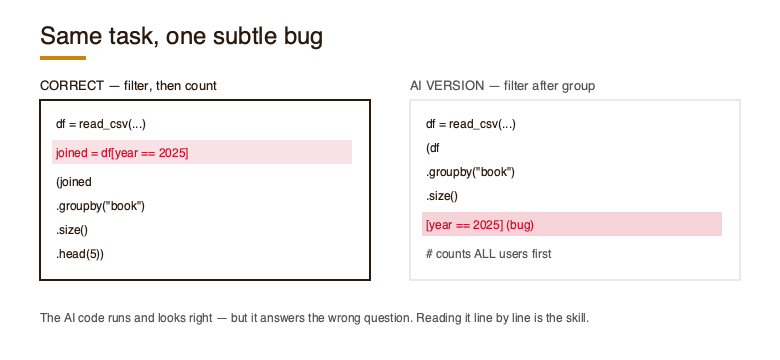

## Exercises

1. **(Warm-up.)** Use `groupby` to get **average session length per platform** from a described DataFrame.
2. **(Representative.)** Reproduce this SQL in pandas: `SELECT city, SUM(revenue) FROM sales GROUP BY city`.
3. **(Stretch.)** Given AI-generated pandas code for a stated task, decide whether to trust it, find any bug, and write two sentences you'd tell an interviewer about your AI-use approach.

---

*Next:* the round that rewards thinking over computing — the case/business interview.

[^pd]: Wikipedia, "pandas (software)," https://en.wikipedia.org/wiki/Pandas_(software) (accessed 2026-07-15).
[^trends7]: `blueprint-trends-notes.md` (2026 guides).
# Chapter 8 — The Case / Business Round

Here the "right answer" matters less than how you **frame the problem, state assumptions, and land a recommendation.** This round asks whether you can think like a business partner, not just run a query.[^trends8]

> **What's tested here**
> Framing, assumptions, insight, and a defensible recommendation — **over raw correctness.**[^trends8] Evaluation spans ~7 dimensions: problem understanding, approach, reasoning, rigor, insight, storytelling, and communication.[^trends8]

## A structure to lean on

When a case opens, don't jump straight to the numbers. Use a visible framework — one common one is **PACE**:[^trends8]

- **Plan** — clarify the objective and success metric.
- **Analyze** — what data would you pull, what would you check.
- **Construct** — turn findings into an answer.
- **Execute** — the recommendation and next step.

PACE comes from Google's Advanced Data Analytics program; it's one common structure, not the only one — use it as scaffolding, not a script.[^pace]

## "How would you measure the success of X?"

A recurring question type. Answer with structure:
1. **Goal** — what "success" means for feature X.
2. **Primary metric** — the one number that captures it.
3. **Guardrails** — metrics that must *not* get worse.
4. **Segments & time frame** — for whom, over how long.

## The take-home case study

A 2026 norm at many companies: a real-feeling business question on **intentionally messy data** (usually 3–4 seeded quality issues), with a time cap (~3 hours) and a **presentation** afterward.[^trends8]

Budget it:
- **First 20 min:** read the prompt, define the question, scan the data for the seeded issues.
- **Middle:** clean, analyze, find the one insight worth presenting.
- **Last 30 min:** build the one-slide story — don't run out of time before you can *tell* it.

## Presenting findings

Lead with the **insight and recommendation**, then support it. One clear slide beats five busy ones. Expect pushback — defend with your assumptions, and concede what you didn't have time to check.

## Worked example

An invented ride-share company: *"Weekend rides have been flat for two months. What's going on?"*

- **Weak:** immediately querying random tables.
- **Strong:** "First, what's 'flat' — flat rides, or flat *relative to* growth elsewhere? I'd check whether it's demand (fewer riders opening the app) or supply (fewer drivers online), segment by city, and compare against weekday trend. My hypothesis is a supply shortage in two growth cities; I'd confirm with driver-online-hours before recommending driver incentives."

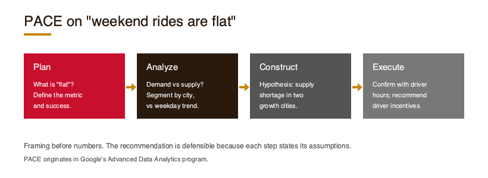

## Exercises

1. **(Warm-up.)** List, in priority order, what an interviewer scores in a case round.
2. **(Representative.)** "How would you measure the success of a new in-app messaging feature?" Give a structured answer with a primary metric and two guardrails.
3. **(Stretch.)** Given an original messy-data take-home prompt, outline your 3-hour plan and the one-slide finding you'd aim for.

---

*Next:* the round that often decides a tie — behavioral.

[^trends8]: Case-round expectations, take-home norms, and evaluation dimensions from 2026 guides recorded in `blueprint-trends-notes.md`.
[^pace]: The PACE framework (Plan, Analyze, Construct, Execute) originates in Google's Advanced Data Analytics program (offered via Coursera). Verified 2026-07-15.
# Chapter 9 — The Behavioral Round

When two candidates are technically even, the behavioral round often decides the offer.[^trends9] It's not small talk — it's a structured check on how you work with people and handle difficulty.

> **What's tested here**
> Collaboration, ownership, handling ambiguity, and influence without authority.[^trends9] Panels want **specific, evidenced stories**, not adjectives about yourself.

## The STAR method

The **STAR method evaluates candidates by how they answer behavioral and situational questions.**[^star] Structure every answer as:[^star]

- **Situation** — the scenario (brief).
- **Task** — your objective.
- **Action** — what *you* did, and why (not "we").
- **Result** — the outcome, quantified where possible, and what you learned.

STAR fits questions on conflict, time management, problem-solving, and interpersonal skills.[^star]

> ⚠️ **The common failure:** all Situation, no Result. Candidates set up the scene and never say what happened. The Result is the point.

## Build a story bank

Don't script per question — prepare **5–6 real stories** and map each to competencies:

| Story | Covers |
|---|---|
| A project you owned | ownership, initiative |
| A disagreement | conflict, influence |
| A failure | resilience, learning |
| An ambiguous task | judgment under uncertainty |
| A deadline crunch | prioritization |

One good story often answers several question archetypes.

## Delivery

Keep it short and specific, and be honest. Quantify results where you can ("cut the report time from 3 hours to 20 minutes"). Read what the question is *really* after — "tell me about a conflict" is scoring how you handle disagreement, not whether you won.

## Worked example

**Q: "Tell me about a time you disagreed with a teammate."**

*Weak:* "We disagreed about a chart once but it worked out fine." (Vague; no task, action, or result.)

*STAR rewrite:* "**S** — On my internship, a teammate wanted to report signups including test accounts. **T** — I needed the number to be accurate for the leadership deck. **A** — I pulled both figures, showed the ~12% inflation from test data, and proposed a filter we both agreed on. **R** — We shipped the corrected metric; it became the team's standard definition." *(Competency scored: influence + data judgment.)*

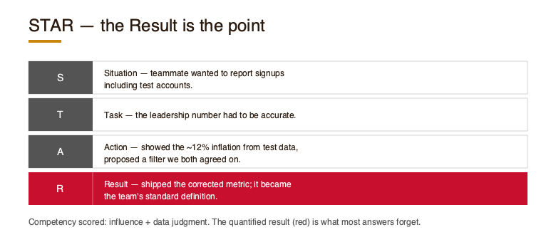

## Exercises

1. **(Warm-up.)** Match five behavioral questions to the competency each targets (conflict, ambiguity, ownership, prioritization, failure).
2. **(Representative.)** Draft one STAR story from your own experience for "a time you handled ambiguity."
3. **(Stretch.)** Score a sample behavioral answer against its target competency and suggest one improvement.

---

*Next:* put all nine stages together — the full mock loop.

[^trends9]: `blueprint-trends-notes.md`.
[^star]: Wikipedia, "Situation, task, action, result," https://en.wikipedia.org/wiki/Situation,_task,_action,_result (accessed 2026-07-15).
# Chapter 10 — Putting It Together: The Full Loop & Mock Interviews

You've walked every stage once. Now assemble them into a **realistic loop, score yourself against each stage's pattern, and turn the scores into a final-week plan.**

> **What's tested here (by you, on yourself)**
> Whether you can perform each stage back-to-back under time pressure — and honestly diagnose where you're weak.

## Run the loop

Simulate the real sequence in one sitting, timed:

1. Recruiter-style intro (5 min) — your present/past/why.
2. SQL problem (20 min) — one from Chapters 3–4.
3. Stats/experimentation question (10 min) — Chapter 5.
4. Case prompt (20 min) — Chapter 8, thinking aloud.
5. Two behavioral questions (10 min) — Chapter 9, STAR.

Record yourself if you can. The goal isn't a perfect run — it's data on your weak spots.

## Self-scoring rubric

Score each stage 1–3 against *its own* "what's tested here" (each rubric row traces back to that chapter):

| Stage | 1 (weak) | 2 | 3 (strong) |
|---|---|---|---|
| Screen | Rambled | Covered basics | Crisp present/past/why |
| SQL | Stuck / silent | Correct, quiet | Correct **and** narrated |
| Stats | Misused p-value | Right idea, shaky | Reasoned, stated assumptions |
| Case | Jumped to numbers | Some structure | Framed → insight → rec |
| Behavioral | All situation | STAR, no result | STAR with quantified result |

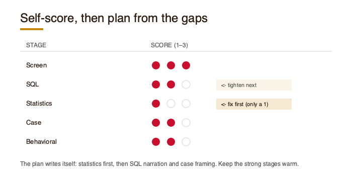

## Manage the real day

- Real loops span hours — **eat, hydrate, and reset** between rounds.
- A rough round is not the loop; interviewers score stages independently.
- Have questions ready for every interviewer.

## The final-week plan

Turn your scores into action:
- **Re-drill your two lowest stages** — most of your remaining time.
- **Maintain your strong stages** — one light rep each.
- **Rehearse logistics** — setup, timing, and your questions for them.

## Worked example

A completed loop for an invented candidate scores: Screen 3, SQL 2, Stats 1, Case 2, Behavioral 2. The plan writes itself — **statistics first** (the only 1), then tighten SQL narration and case framing, keep the screen warm.

## Exercises

1. **(Representative.)** Run a self-timed mini-mock: one prompt per stage from earlier chapters. Record your answers.
2. **(Representative.)** Self-score with the rubric above and identify your **two weakest** stages.
3. **(Stretch.)** Design your final-week prep plan from the self-scoring — time allocated by weakness and stage weight.

---

*You now have the map, the skills, and a way to measure yourself against each stage. Prepare by stage, practice out loud, and walk in knowing exactly what each interviewer is looking for.*
